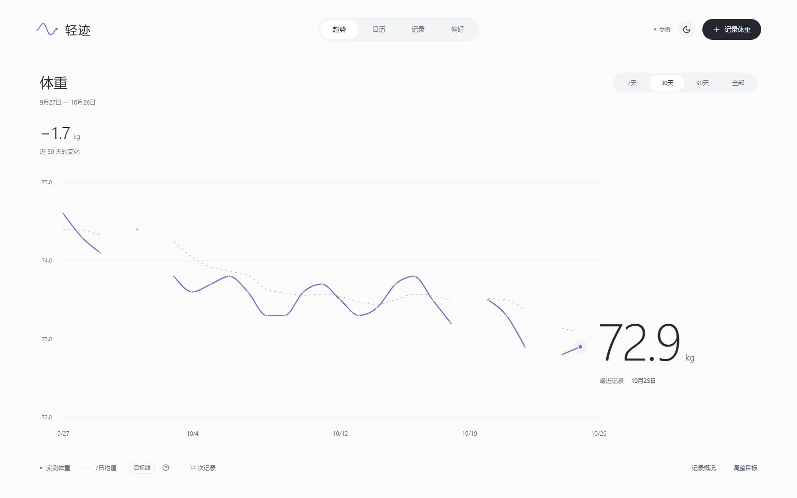

# WeightRecorder · 轻迹

一个以体重轨迹为中心的本地日记。打开就是完整的趋势画布，最近体重直接标在曲线末端；日历、记录、概况和偏好各有独立页面。数据保存在自己的电脑里。



视觉采用冷白、石墨和低饱和鸢尾色，以原生系统字体、轻量数字和留白建立层级。[设计说明与原始画稿](docs/design/2026-10-26-direction.md)记录了先设计、审视再实现的过程；另有[深色](docs/screenshots/trend-dark.png)与[手机](docs/screenshots/trend-mobile.png)实拍。

## 开始使用

需要 **Node.js 24+**。当前电脑上的依赖已经安装完成。

**Windows：双击根目录的 `启动轻迹.cmd`。** 首次运行会准备依赖和生产构建，然后自动打开 [http://127.0.0.1:3210](http://127.0.0.1:3210)。保持启动窗口运行，关闭窗口或按 `Ctrl+C` 停止服务，数据会保留。

也可以在终端运行：

```powershell
pnpm install --frozen-lockfile
pnpm start
```

安装了标准 Node.js、尚未安装 pnpm 时，可以使用 `npm install`、`npm start`。仓库以 `pnpm-lock.yaml` 锁定依赖，开发和 CI 使用 pnpm。

开发与验证：

```powershell
pnpm dev      # 本地 API + Vite 热更新，同一个地址
pnpm check    # TypeScript 严格类型检查
pnpm test     # 日期、统计、CSV 和真实 SQLite / HTTP 集成测试
pnpm build    # 类型检查 + 前端生产构建
pnpm serve    # 直接运行已经构建的版本，不自动打开浏览器
```

自定义端口：`powershell -File scripts/start.ps1 -Port 3211`。不自动打开浏览器：加上 `-NoBrowser`。

## 功能

- **每日记录**：每天一条记录，支持补记、编辑、备注和状态；当天已有记录时直接更新，避免重复。
- **趋势首页**：大幅曲线与末端读数，7 / 30 / 90 天和全部范围；可切换 7 日均值与目标线。
- **记录概况**：从首页选择进入，查看均值、累计变化、连续记录、近 13 周记录分布与目标进度。
- **真实数据表达**：实测体重与 7 日移动均值分开显示；缺失日期保留空白，不生成虚构测量值。
- **记录日历**：按月浏览，点击日期查看详情或补记，未来日期不可记录。
- **全部记录**：日期和随记搜索、日期区间筛选、排序、分页、编辑和删除确认。
- **个人目标**：支持增重或减重方向，自行设置目标；从第一笔记录计算进度，不自动推荐体重。
- **分区偏好**：个人、外观、数据、接口四个独立分区；浅色 / 深色 / 跟随系统，公斤 / 磅。数据统一以 kg 存储，展示时换算。
- **数据迁移**：JSON 完整备份、CSV 导入导出。导入前预览数量，重复日期保留本地记录，整个文件校验成功才提交。
- **独立示例空间**：首次空库自动展示示例，点击右上角“示例”进入干净的个人空间。示例只在内存中，刷新重置，不写进个人数据库；示例导出文件包含 `demo` 标记。
- **快捷操作**：按 `N` 打开录入弹窗，按 `Esc` 关闭。支持窄屏布局和键盘操作。

## 数据与备份

默认数据库位于 **`data/weight-recorder.sqlite`**，第一次启动时自动创建，与浏览器缓存无关。`data/`、数据库和本地备份已加入 `.gitignore`，不会随源码提交。

在“偏好 → 数据”中导出 JSON 备份，迁移电脑后导入即可恢复记录和设置。CSV 用于表格交换，至少包含 `date,weight_kg` 两列，体重始终使用 kg；可选 `note,mood`。CSV 导入保留当前设置。状态值为 `good`、`neutral`、`tired`。

```csv
date,weight_kg,note,mood
2026-10-22,72.9,晨起空腹,good
2026-10-23,72.6,散步后感觉不错,neutral
```

日期使用测量当天的本地自然日，不使用 UTC 日期替代。最近 7 日和之前 7 日为相邻、互不重叠的自然日窗口，只对实际记录求均值。连续记录可以从今天或尚未记录今天时的昨天开始，遇缺失日中断。

服务仅监听 `127.0.0.1`，不需要登录，不调用云端或大模型。当前不是多用户服务，也未实现跨设备同步；这台电脑上可访问本地端口的应用具有访问数据的能力。页面字体、图标、脚本均随应用提供，安装后日常使用无需互联网。

## 技术与扩展

前端使用 **React 19、TypeScript、Vite 7、Recharts 3、Lucide**；后端使用 **Node.js 24、Express 5、Zod 4、内置 SQLite**。版本以锁文件为准，不依赖原生 npm 数据库模块的额外编译步骤。

```text
src/                  React 界面、交互与主题
src/repository.ts     HTTP / 示例两个 WeightRepository 适配器
shared/               类型契约、日期、统计和 CSV 逻辑
server/               REST 路由、校验、SQLite 适配器
tests/                领域与真实 API / 数据库集成测试
scripts/              Windows 启动和生产构建启动器
docs/                 扩展设计与验证记录
```

已提供版本化 REST API **`/api/v1`**：

| 接口 | 用途 |
| --- | --- |
| `GET /snapshot` | 全部记录和设置 |
| `GET /entries?from=YYYY-MM-DD&to=YYYY-MM-DD` | 按日期筛选记录 |
| `POST /entries` | 新建记录，日期重复返回 409 |
| `PUT /entries/{id}` | 编辑记录 |
| `DELETE /entries/{id}` | 删除记录 |
| `PATCH /settings` | 更新个人设置 |
| `GET /summary?asOf=YYYY-MM-DD` | 截至指定日期的描述统计 |
| `GET /export?format=json` | 完整备份；也支持 `csv` |
| `POST /import` | 事务式合并 JSON 备份 |
| `GET /agent/context` | 供未来 Agent 使用的只读、带解释边界的事实上下文 |
| `GET /openapi.json` | OpenAPI 3.1 契约 |

除导出、OpenAPI 和 204 响应外，成功响应使用 `{ "data": ... }`；错误响应使用 `{ "error": { "code": "...", "message": "..." } }`。详细设计见 [扩展接口说明](docs/architecture.md)。

未来 iOS 可使用 SwiftUI 绘制原生界面并按 OpenAPI 对接，或增加独立设备内存储适配器。未来 Agent 可通过上下文接口和显式写入工具调用业务层。**当前版本没有接入大模型、Apple Health、iCloud 或远程同步。**

技术参考：[React](https://react.dev/)、[Vite](https://vite.dev/guide/)、[Recharts](https://recharts.github.io/en-US/api/)、[Express](https://expressjs.com/en/5x/api/)、[Node.js SQLite](https://nodejs.org/docs/latest-v24.x/api/sqlite.html)。
