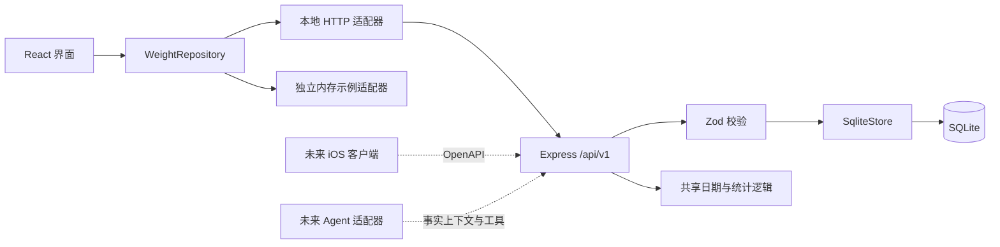

# 轻迹：本地架构与扩展契约

当前范围是单用户本地工具。浏览器通过同源 `/api/v1` 访问 Node.js 服务，SQLite 是个人数据的唯一持久化来源；浏览器缓存只保存外观与示例空间偏好。

## 边界



`shared/types.ts` 定义数据和异步仓储接口；`shared/domain.ts` 不依赖 React、HTTP 或 SQLite。服务端 `SqliteStore` 是独立存储适配器，API 负责输入校验和错误映射。示例适配器没有访问个人数据库的路径。

## 数据约定

每个本地自然日最多一条记录：

```json
{
  "date": "2026-10-23",
  "weightKg": 72.6,
  "note": "晨起空腹",
  "mood": "good"
}
```

服务端生成 UUID、`createdAt` 和 `updatedAt`。体重统一用 kg；界面使用一位小数，磅录入换算到 kg 后保留三位小数。日期是 `YYYY-MM-DD`，审计时间是 ISO 8601 UTC。自然日运算使用 UTC 中午做日历运算，避免夏令时造成一天不是 24 小时的问题，不把测量日期转换成 UTC 日期。

`date` 有数据库唯一约束；创建同日期返回 `409 DATE_CONFLICT`。编辑必须指定原记录 ID，不做隐式覆盖。JSON 导入先验证全部输入，在单个 `BEGIN IMMEDIATE` 事务中按日期合并、恢复设置；本地已有日期优先，输入内部重复日期也只导入首条。失败整体回滚。单次不超过 20,000 条 / 8 MB。

SQLite 开启 WAL、5 秒 busy timeout 和 `user_version = 1`。当前只有第一版 schema；未来结构变更应增加按 `user_version` 递增的迁移，不能靠覆盖现有数据库升级。运行中优先使用 JSON 导出备份；直接复制数据库文件前先停止服务，让 WAL 正常收敛。

## API 使用

启动后访问 `http://127.0.0.1:3210/api/v1/openapi.json` 获取机器可读契约。例如 PowerShell：

```powershell
$entry = @{ date = (Get-Date -Format 'yyyy-MM-dd'); weightKg = 72.6; note = '晨起空腹'; mood = 'good' } | ConvertTo-Json
Invoke-RestMethod -Method Post -Uri 'http://127.0.0.1:3210/api/v1/entries' -ContentType 'application/json' -Body ([System.Text.Encoding]::UTF8.GetBytes($entry))
Invoke-RestMethod -Uri 'http://127.0.0.1:3210/api/v1/summary'
```

写请求要求 JSON；带 Origin 的请求必须来自当前主机同源。服务监听回环地址并检查 Host，不开放 CORS。当前没有远程认证、账户隔离、速率限制或 TLS 终止，因此不能直接把服务绑定到公网来实现手机同步。

## iOS 扩展路径

1. 使用 OpenAPI 中的稳定字段生成或手写 Swift `Codable` 模型，保持 `date` 与 kg 单位语义。
2. 使用 SwiftUI 绘制原生页面，新增 iOS repository，不把桌面文件路径当作跨端契约。
3. 需要跨设备时另行实现身份认证、加密传输、设备配对、同步队列和冲突规则。现有回环服务不作为直接公网服务。
4. 需要完全独立离线运行时，以设备数据库实现相同业务约定；统计逻辑根据公开测试用例做一致性验证。
5. Apple Health、iCloud 等集成独立实现，并由用户显式授权；当前没有这些权限或后台能力。

## Agent 扩展路径

`GET /agent/context` 提供当前日期、实际时区、kg 单位、最近 30 条实测记录、统计结果、解释边界以及 `modelConnected: false`。它没有调用模型，也没有生成预测。

未来模型提供商、密钥和会话应放在服务端独立适配器中。工具层可映射 OpenAPI 的 `recordWeight`、`listWeightEntries`、`getWeightSummary` 等 operationId，并复用现有输入校验。删除、目标修改、导入等写操作应在产品中保留具体变更预览及用户确认，避免让模型直接执行 SQL。

短期体重波动不足以解释体脂变化；缺失日期表示未测量。统计是记录的描述，不是诊断或减重方案。这些边界作为上下文的一部分提供给未来 Agent。
